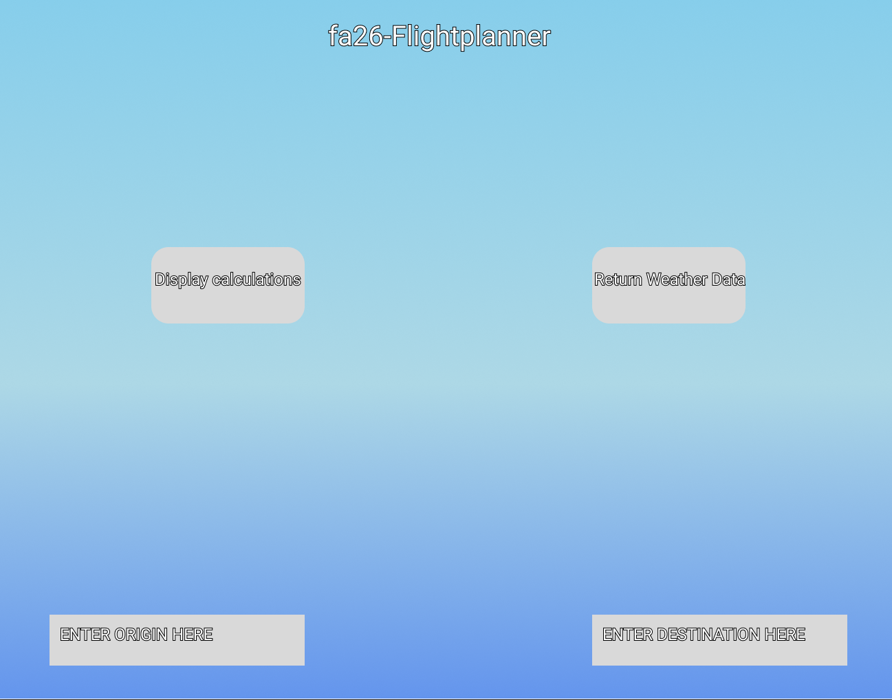
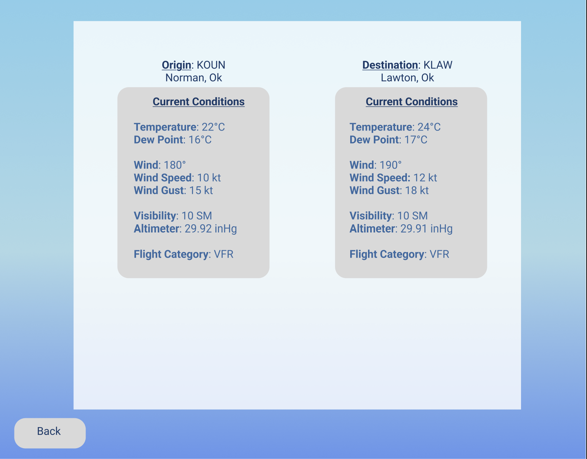
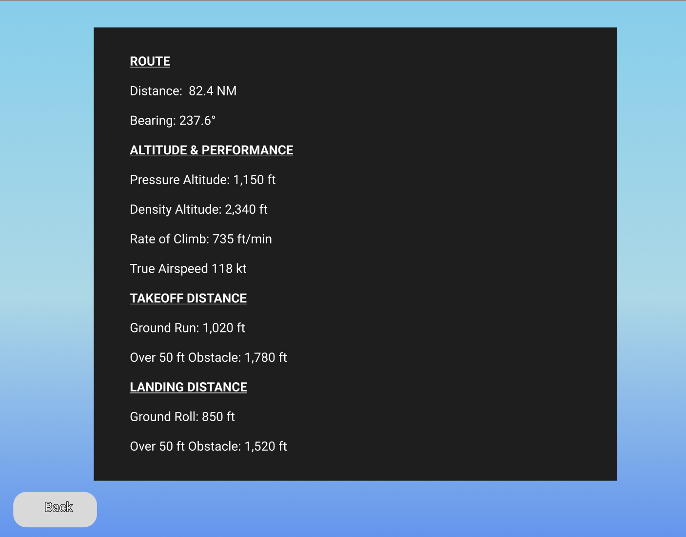
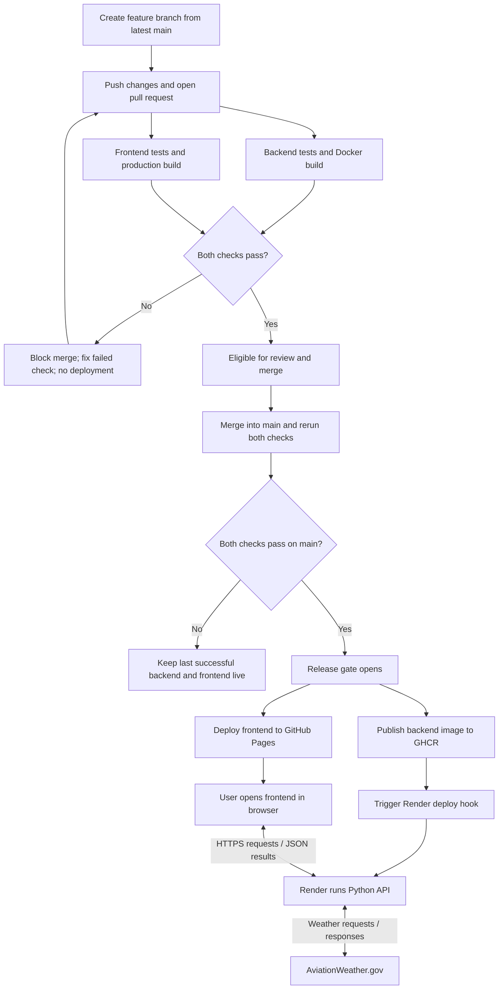

# Cross-Country Flight Planner

[](https://github.com/OU-CS-4273-Capstone-Grounds/fa26-flightplanner/actions/workflows/ci.yml)


### CS 4273 Capstone Design Project (Fall 2026) - Group D

**Last Updated:** October 6, 2026

A software-based system that helps pilots plan cross-country flights, replacing the traditional pen-and-paper process, and that doubles as a step-by-step learning and practice tool for students and new pilots.

## Table of Contents

- [Project Description](#project-description)
- [Features](#features)
- [Screenshots](#screenshots)
- [Installation](#installation)
- [Usage](#usage)
  - [Start the API](#start-the-api)
  - [Start the CLI](#start-the-cli)
  - [Running Tests](#running-tests)
- [Technologies & Tools](#technologies--tools)
- [Planned Hosting and Deployment Workflow](#planned-hosting-and-deployment-workflow)
- [Goals & Progress Plan](#goals--progress-plan)
- [Contributing](#contributing)
- [Team Members](#team-members)
- [License](#license)
- [Repository](#repository)

## Project Description

The Flight Planner project is a software-based system designed to assist pilots with cross-country flight planning by replacing the traditional pen-and-paper process used.

Traditionally, pilots use paper navigation logs, aircraft performance information, weather data, route information, and tools such as the
E6-B flight computer to determine factors including distance, flight time, fuel consumption, headings, waypoints, climb performance, and descent performance.

Beyond serving solely as a planning tool, the system is designed to double as a **learning and practice tool**, helping students and new pilots understand and work through the flight-planning process step-by-step, rather than simply producing a final number.

The goal of this project is to create a system intended to serve two purposes:

1. **Flight-planning assistance** — Help pilots organize the information and calculations involved in preparing a cross-country flight.
2. **Learning and practice** — Allow users to practice and better understand the calculations and decision-making involved in traditional flight planning.

The software is intended to support the pilot's decision-making process rather than replace official aviation resources or pilot judgment.

## Features

**Available now:**

- **Command-line interface** — prompts for departure and destination ICAO airport identifiers and validates them.
- **HTTP API** (FastAPI) — health check and density-altitude endpoints, with interactive docs at `/docs`.
- **Live aviation weather** — fetches METAR and TAF data from AviationWeather.gov.
- **Flight calculations** — density altitude, pressure altitude, wind correction angle, true heading, ground speed, great-circle distance and bearing, and unit conversions.
- **Docker image and CI** — GitHub Actions runs the test suite and Docker build checks on every push and pull request.

**Planned:** fuel burn and waypoint planning, a web frontend, a step-by-step practice/learning mode, and automated deployment (see [Goals & Progress Plan](#goals--progress-plan)).

### Key Project Feature: Density Altitude Calculation

One of the calculations the system replaces from the E6-B and paper performance charts is **density altitude** the pressure altitude corrected for temperature. It's the single input that nearly every other performance chart in the aircraft's POH depends on: rate of climb, true airspeed, takeoff/landing distance, and range are all plotted against density altitude.

**Inputs:**
- Pressure Altitude (PA) — altitude read off the altimeter when set to 29.92" Hg
- Outside Air Temperature (OAT), in °C

**Output:** Density Altitude (ft) — used downstream by the system to look up expected climb rate, true airspeed, takeoff/landing distance, and fuel range for the planned flight.

**Why this feature matters:** Nearly every aircraft performance figure (climb rate, takeoff roll, landing distance, range) is only accurate once corrected for density altitude. Getting this calculation right is important for the rest of the performance-planning features build on.

## Screenshots

UI mockups for the planned frontend (Figma source: [`UIMockUp/UIMockUp1/FlightPlannerCAPSTONE.fig`](UIMockUp/UIMockUp1/FlightPlannerCAPSTONE.fig)):

| Home page | Weather data | Calculations |
|---|---|---|
|  |  |  |

## Installation

Docker is the main way to run this project. Running locally with Python is also supported for development.

### Prerequisites

- [Docker](https://www.docker.com/) (recommended)
- Python 3.13 (only needed to run locally or to run the tests)

### Steps

1. Clone the repository:

   ```bash
   git clone https://github.com/OU-CS-4273-Capstone-Grounds/fa26-flightplanner.git
   cd fa26-flightplanner
   ```

2. From the repository root, build the Docker image:

   ```bash
   docker build -t flight-planner .
   ```

3. *(Optional, for running locally)* From the repository root, create and activate a virtual environment, then install the dependencies:

   ```bash
   python3 -m venv .venv
   source .venv/bin/activate
   python -m pip install -r requirements.txt
   ```

## Usage

### Start the API

#### Run with Docker

After building the image, run it with port 8000 published:

```bash
docker run --rm -p 8000:8000 flight-planner
```

The API runs at `http://127.0.0.1:8000`. Open `/docs` for interactive API documentation
or `/openapi.json` for the schema.

- `GET /health` returns `{"status":"ok"}` without calling external services.
- `POST /api/v1/calculations/density-altitude` calls the existing calculation function.

Example request:

```bash
curl -X POST http://127.0.0.1:8000/api/v1/calculations/density-altitude \
  -H "Content-Type: application/json" \
  -d '{"temperature_c": 25, "field_elevation_ft": 1200, "altimeter_inhg": 29.92}'
```

Example response:

```json
{"density_altitude_ft":2688.0}
```

#### Run locally

Install `requirements.txt` using the [installation instructions](#installation) above, then run:

```bash
python -m uvicorn src.api:app --reload
```

The API is served at the same address, `http://127.0.0.1:8000`.

### Start the CLI

#### Run with Docker

From the repository root, run the image with an interactive terminal:

```bash
docker run --rm -it flight-planner python -m src.main
```

The CLI will prompt you for the four-letter ICAO identifiers of the departure and destination airports.

#### Run locally

With the virtual environment active, start the CLI:

```bash
python -m src.main
```

### Running Tests

Run all tests with:

```bash
python -m pytest tests -v
```

API tests use FastAPI's TestClient and do not need a running server or weather service.

## Technologies & Tools

| Technology | Purpose |
|---|---|
| **Python** | Primary programming language for implementing mathematical and data-processing logic for calculations involving flight time, fuel consumption, climb and descent performance, waypoint calculations, aircraft performance information, and weather information|
| **AviationWeather.gov / SkyVector.com APIs** | Live aviation weather data  [METAR](https://aviationweather.gov/api/data/metar) and [TAF](https://aviationweather.gov/api/data/taf) endpoints feed real wind, visibility, and forecast data into the planning calculations |
| **Docker** | Packages the Python backend and its dependencies into an image for consistent development and deployment |
| **GitHub Actions** | Runs automated tests and Docker build checks on pushes/PRs; planned deployment automation will publish images and trigger hosting updates after successful checks on `main` |
| **GitHub Container Registry (GHCR)** | Will store versioned backend Docker images built by GitHub Actions |
| **Render Web Service** | Will pull the backend image from GHCR and run the Python HTTP API at a public HTTPS URL |
| **GitHub Pages** | Will host the static frontend, which calls the Render backend from the user's browser |
| **Jira** | Project planning and task organization to track team progress |

### Learning Resources

- Python: [learnpython.org](https://www.learnpython.org/)
- GitHub Actions: [docs.github.com/en/actions](https://docs.github.com/en/actions)
- Docker: [Docker 101 Tutorial](https://www.docker.com/101-tutorial/)
- GHCR: [Publishing Docker images with GitHub Actions](https://docs.github.com/en/actions/tutorials/publish-packages/publish-docker-images)
- Render: [Deploy a prebuilt Docker image](https://render.com/docs/deploying-an-image)
- GitHub Pages: [What is GitHub Pages?](https://docs.github.com/en/pages/getting-started-with-github-pages/what-is-github-pages)
- Jira: [Atlassian Jira Getting Started Guide](https://www.atlassian.com/software/jira/guides/getting-started/introduction)
- Aviation weather data: aviationweather.gov / SkyVector.com

## Planned Hosting and Deployment Workflow

The frontend will be hosted on **GitHub Pages**, and the Python backend will run as a **Render Web Service**. **GitHub Container Registry (GHCR)** will store the backend Docker images. GitHub Actions will connect these services by testing changes, building and publishing images, and triggering deployment.

**Current status:** The repository has a Python CLI and a basic FastAPI API with health and density-altitude endpoints. Docker starts the HTTP server on port 8000, and CI runs tests and container startup checks. Additional API endpoints, frontend integration, image publishing, and hosting deployments still need to be implemented. Configure the hosting port and frontend CORS origin when adding deployment support.

### Deployment Steps

1. Team members create a feature branch from the latest `main`, push changes to that feature branch, and open a pull request into `main`.
2. GitHub Actions runs the backend checks (Python tests and Docker build) and frontend checks (tests and production build) independently on the pull request.
3. If both sets of checks pass, the pull request is eligible for review and merge. Passing checks do not deploy code from the feature branch.
4. If either set of checks fails, the pull request is blocked from merging. This includes cases where the backend passes but the frontend fails, or the frontend passes but the backend fails. Team members fix the failed check on the same feature branch, and GitHub Actions reruns the checks. Neither component is deployed while the pull request is blocked.
5. After the pull request merges into `main`, GitHub Actions reruns both sets of checks against the merged commit. A shared release gate continues only when both sets pass.
6. After the release gate passes, GitHub Actions publishes the backend image to `ghcr.io/ou-cs-4273-capstone-grounds/fa26-flightplanner`, tagged "latest", and calls a Render deploy hook. Render pulls the image and starts the backend. Publishing a new image alone does not trigger a Render deployment.
7. The same release deploys the successfully built frontend to GitHub Pages. If either check fails on `main`, neither the backend nor frontend is deployed, and the last successful versions remain live.
8. Users open the frontend in their browser. It sends HTTPS requests to the Render API, which performs calculations or fetches aviation weather and returns JSON results.

### Workflow Diagram



### Hosting Configuration

- **Image publishing:** Use the GitHub Actions `GITHUB_TOKEN` with `contents: read` and `packages: write`. Build a `linux/amd64` image for Render and deploy a specific image digest or commit tag so releases are traceable.
- **Render:** Select **Web Service**, then **Existing Image**, and supply the GHCR image URL. If the image is private, configure a registry credential with `read:packages`. Store the Render deploy hook URL as a GitHub Actions secret.
- **Backend:** Listen on `0.0.0.0` and the port configured by Render. Allow the frontend origin, `https://ou-cs-4273-capstone-grounds.github.io`, through CORS.
- **Frontend:** Configure the Render API's HTTPS URL and the GitHub Pages project base path, `/fa26-flightplanner/`. Keep credentials in backend environment variables or GitHub Actions secrets.

## Goals & Progress Plan

**Overall goal:** Deliver a working flight-planning tool by the end of the semester that a pilot or student could realistically use to plan a cross-country flight, with wind, fuel, distance, and waypoint calculations pulling from live aviation weather data.

**Progress plan (tracked via Jira, tickets scoped per sprint):**

1. **Domain understanding & tech setup**  — finalize tech stack, set up Docker environment, connect to aviationweather.gov endpoints, confirm formulas for wind triangle/fuel/distance calculations.
2. **Core calculation engine** — implement and unit-test wind correction angle, ground speed, fuel burn, and distance/waypoint calculations in Python.
3. **Weather data integration** — pull live METAR/TAF data from aviationweather.gov and feed it into the calculation engine.
4. **CI/CD pipeline** — set up GitHub Actions to run the test suite automatically on every push/PR.
5. **User-facing interface** — build a simple UI for entering a route and viewing the full flight plan output.
6. **Practice/learning mode** — add a mode that walks a user through the planning process step-by-step rather than just showing final results.
7. **Review & polish** — incorporate feedback from our mentor, refine documentation and test coverage.

## Contributing

Work is tracked in Jira, and each branch is named after its ticket (for example, `CAPD-34`).

1. Create a feature branch from the latest `main`: `git checkout -b CAPD-XX`.
2. Make your changes. Add future endpoints in `src/api.py`, keeping calculation logic in `src/calculations.py`.
3. Run the tests locally with `python -m pytest tests -v`.
4. Push your branch: `git push origin CAPD-XX`.
5. Open a pull request into `main`. GitHub Actions must pass before the pull request can be reviewed and merged (see [Deployment Steps](#deployment-steps)).

## Team Members

- Reese Zimmermann — Product Owner
- Avinash Kandadi — Sprint Master 1
- Sahith Gondi — Sprint Master 2
- Sean Ropp — Sprint Master 3
- Elise Alvarado — Sprint Master 4
- Nic Grounds — Mentor / Client

## License

No license has been chosen for this project yet.

## Repository

**GitHub Repository:**
https://github.com/OU-CS-4273-Capstone-Grounds/fa26-flightplanner
